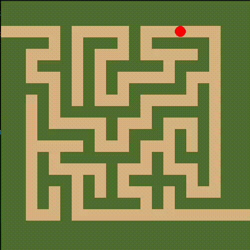

# RL-Maze-Solver
This program utilizes a tabular Q-learning algorithm to navigate randomly generated mazes.
The mazes are carved via random DFS. The agent is not able to generalize yet, so it needs time to
relearn the layout every time the maze gets changed.
## Quickstart
Create mazes by running:
```
python Maze.py
```
## Controls
```
q - quit
r - randomize maze
w - increase max fps (speed up)
s - decrease max fps (slow down)
```
## Demo

